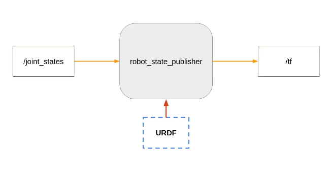

RViz (Robot Visualization)
---------------------------
* 3D visualization tool to display robot model


TF (TransForm)
--------------
There are two perspectives to understand the Transform (tf2)

Programmers Perspective:
 - Use URDF file(XML) to describe robot's physical anatomy
 - Link -> used to define the body parts
 - Joints -> define how these links connect and it's orientation

Under the hood (Computational perspective):
 - tf2 manages the tree of coordinate frames for each links
 - relationship b/w 2 links is represented by Transformation Matrix
 - Transformation Matrix - combines 3D translation vector + 3D rotation matrix
 - when ever a position of a link is requested to tf2 by ros => tf2 traverses the tree, calculate transformation matrix and returns relative position and orientation


 LINK & JOINTS ASSOCIATION:
 -------------------------
- all body/parts of a robot are defined as 'Link' (rigid part of a robot)
- Each link has it's own coordinate frame (x, y, z) and the origin is at
   the center of the link
- Links are connected/attached together by 'Joint' 
- links are attached to joint as parent-child relation (as denoted in tree)
- so if a joint's position moved, then all the child link's origin get changed too


THINGS TO REMEMBER:
-------------------
* each link has it's own coordinate axis
* the origin of these coordinate axis is at the center of the link
* always position the joint, so that the child link also move with it
* X axis - red (towards you)
* Y axis - green (right side)
* Z axis - blue (upwards)


```bash
sudo apt install ros-jazzy-tf2-tools

# run this while the model is running, this command will capture all the tf data
# and generate a tf tree of how each link is connected as a pdf file
ros2 run tf2_tools view_frames

# if we move one link(node) in the tf tree, then all the child links will move

# all installed packages are found at location
/opt/ros/jazzy/share

sudo apt install ros-jazzy-urdf-tutorial

# run a urdf tutorial to view robot in RViz
ros2 launch urdf_tutorial display.launch.py model:=/opt/ros/jazzy/share/urdf_tutorial/urdf/08-macroed.urdf.xacro

# urdf_tutorial package can be used to visualize any urdf files just by passing
# the urdf file path as argument to model
ros2 launch urdf_tutorial display.launch.py model:=$(pwd)/robot_a.urdf
```

HOW TO VISUALIZE URDF FILE WITHOUT urdf_tutorial PACKAGE:
---------------------------------------------------------


* urdf_tutorial package uses below steps to visualize urdf
  * uses package robot_state_publisher
    * takes the urdf file as parameter
    * takes the joint states via subscribing to /joint_states topic
    * publishes the data via topic /tf
* this topic(/tf) is subscribed by another node, for RViz

```bash
# start robot_state_publisher pkg by passing urdf file as parameter
ros2 run robot_state_publisher robot_state_publisher --ros-params -p robot_description:="$(xacro robot_a.urdf)"

# start the joint_state_publisher pkg (show slider window to control wheels)
ros2 run joint_state_publisher_gui joint_state_publisher_gui

# to view animated 3D
ros2 run rviz2 rviz2

# Config in the window
# 1. Add > RobotModel
# 2. Add > TF
# 3. Global Options > Fixed Frame > select_base_link
# 4. RobotModel > Description (drop down) > /robot_description
```


How to set these steps in a Launch file?
```bash
# 1.Create a package to hold urdf files (postfix by adding *_description)
ros2 pkg create robot_name_description

# 2.Except CMakeLists & package.xml remove every thing else
# 3.Create urdf folder
# 4.Modify CMakeLists.txt
#   A. remove the BUILD_TESTING if block and add below code

install(
    DIRECTORY urdf
    DESTINATION share/${PROJECT_NAME}/
)

# NOTE: RViz starts with default configuration, which shows empty space. Need to
# manually setup the base_link and other configs. To automate this, pass the 
# rviz config file as argument while starting rviz2 node.
ros2 run rviz2 rviz2 -d rviz_config.rviz

# for *rviz config file: manually set the configs in gui and save it as a file
```


---
