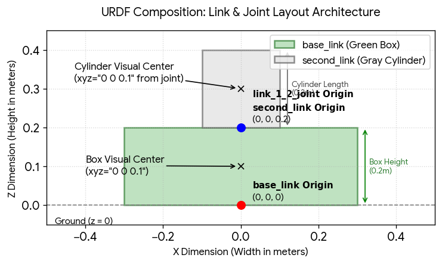

RViz (Robot Visualization)
---------------------------
* 3D visualization tool to display robot model


TF (TransForm)
--------------
There are two perspectives to understand the Transform (tf2)

Programmers Perspective:
 - Use URDF file(XML) to describe robot's physical anatomy
 - Link -> used to define the body parts
 - Joints -> define how these links connect and it's orientation

Under the hood (Computational perspective):
 - tf2 manages the tree of coordinate frames for each links
 - relationship b/w 2 links is represented by Transformation Matrix
 - Transformation Matrix - combines 3D translation vector + 3D rotation matrix
 - when ever a position of a link is requested to tf2 by ros => tf2 traverses the tree, calculate transformation matrix and returns relative position and orientation


 LINK & JOINTS ASSOCIATION:
 -------------------------
- all body/parts of a robot are defined as 'Link' (rigid part of a robot)
- Each link has it's own coordinate frame (x, y, z) and the origin is at
   the center of the link
- Links are connected/attached together by 'Joint' 
- links are attached to joint as parent-child relation (as denoted in tree)
- so if a joint's position moved, then all the child link's origin get changed too




THINGS TO REMEMBER:
* each link has it's own coordinate axis
* the origin of these coordinate axis is at the center of the link
* always position the joint, so that the child link also move with it
* X axis - red (towards you)
* Y axis - green (right side)
* Z axis - blue (upwards)


```bash
sudo apt install ros-jazzy-tf2-tools

# run this while the model is running, this command will capture all the tf data
# and generate a tf tree of how each link is connected as a pdf file
ros2 run tf2_tools view_frames

# if we move one link(node) in the tf tree, then all the child links will move

# all installed packages are found at location
/opt/ros/jazzy/share

sudo apt install ros-jazzy-urdf-tutorial

# run a urdf tutorial to view robot in RViz
ros2 launch urdf_tutorial display.launch.py model:=/opt/ros/jazzy/share/urdf_tutorial/urdf/08-macroed.urdf.xacro

# urdf_tutorial package can be used to visualize any urdf files just by passing
# the urdf file path as argument to model
ros2 launch urdf_tutorial display.launch.py model:=$(pwd)/robot_a.urdf
```


---
